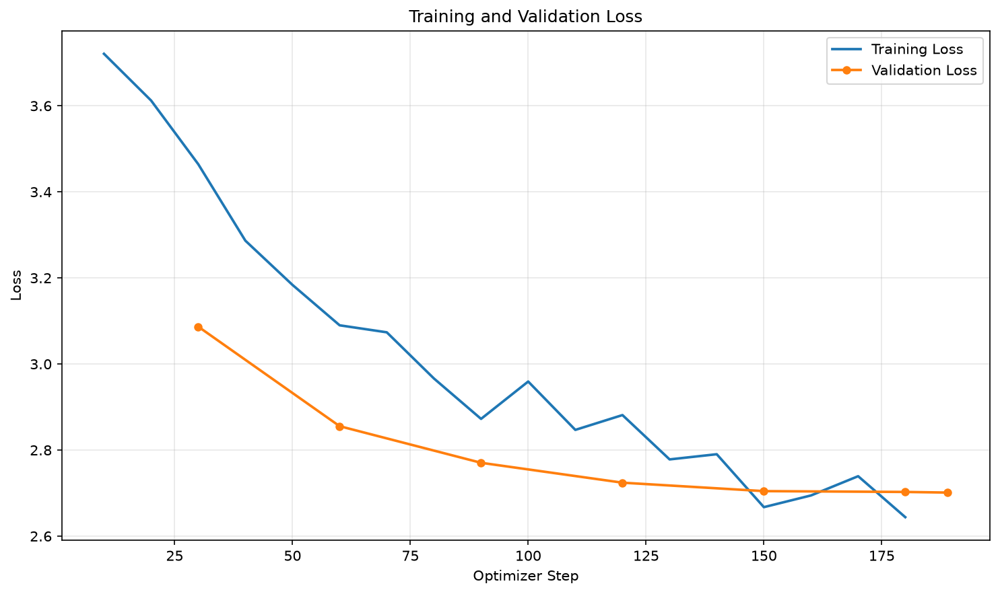

# 土味情話專家（多輪對話 QLoRA）

## 基礎模型

- `Qwen/Qwen2.5-0.5B-Instruct`
- 4-bit QLoRA，適合 4 GB VRAM 的本機 GPU

## 訓練資料來源與資料組成

- 以「土味情話」為主題整理的多輪對話語料，共 403 段、14 個 ShareGPT 批次檔。
- 原始批次、SHA256 與授權說明：`data/raw/README.md`、`data/raw/manifest.json`
- 清理後：388 段對話，保留 2–4 輪使用者發言
- 固定 held-out：15 段（依輪數分層抽樣，seed 42）
- 訓練／驗證：373 段對話 → 1,003 / 109 筆 SFT examples
- 清理統計與丟棄原因：`data/clean_manifest.json`

## 安裝套件

- Python 3.12
- torch `2.14.1+cu126`
- transformers `5.19.0`
- trl `1.13.0`
- peft `0.21.0`
- bitsandbytes `0.50.2`
- datasets `5.1.0`
- accelerate `1.15.0`
- matplotlib `3.11.0`

```bash
# Colab 已內建 torch；本機請先安裝符合 CUDA 版本的 torch
pip install -r requirements-colab.txt
```

## 執行方法

```bash
python build_chat_data.py
python prepare_chat_data.py
python train_qlora.py
python plot_loss.py
python infer_lora.py
python infer_test.py
python infer_lora_chat.py
```

`infer_test.py` 會產生 `infer_test_out.txt`；`infer_lora_chat.py` 則進入多輪互動模式。
若要重新評估 checkpoint（需先重新訓練產生 checkpoint），可執行：

```bash
python eval_checkpoints.py --checkpoints 30,60,90,120,150,180,189 --include-base
```

## 訓練設定

- LoRA：`r=16`, `alpha=32`, `dropout=0.10`, `all-linear`
- Epochs：3（189 optimizer steps）
- Batch：`2 × 8` gradient accumulation（effective batch 16）
- Max length：512
- Learning rate：`5e-5`
- 每 30 steps 評估與儲存 checkpoint，最多保留 8 份

## 訓練結果

- 最終 adapter：`outputs/qwen25_05b_lora`（checkpoint-189）
- 訓練時間：約 29 分鐘
- 平均 training loss：`2.9993`
- 最終 validation eval loss：`2.7012`
- 最終 eval token accuracy：`48.8%`

| Step | Eval loss |
|---:|---:|
| 30 | 3.0868 |
| 60 | 2.8555 |
| 90 | 2.7705 |
| 120 | 2.7242 |
| 150 | 2.7046 |
| 180 | 2.7027 |
| 189 | **2.7012** |



## Checkpoint 選擇

使用 15 段未見的 held-out 對話，以 canonical system prompt、greedy decoding、`max_new_tokens=100` 進行多輪生成；每輪只餵入原始 user 發言與模型自己的歷史回覆，不洩漏參考答案。

| Model | Avg. chars | Ref. similarity | Empty | Truncated | Exact duplicate |
|---|---:|---:|---:|---:|---:|
| Base Qwen2.5-0.5B | 47.70 | 0.1287 | 0 | 0 | 0.0% |
| checkpoint-30 | 18.20 | 0.2151 | 0 | 0 | 2.2% |
| checkpoint-60 | 18.30 | 0.2369 | 0 | 0 | 0.0% |
| checkpoint-90 | 19.87 | 0.2414 | 0 | 1 | 0.0% |
| checkpoint-120 | 17.61 | **0.2428** | 0 | 0 | 0.0% |
| checkpoint-150 | 18.33 | 0.2278 | 0 | 0 | 0.0% |
| checkpoint-180 | 21.17 | 0.2343 | 0 | 0 | 0.0% |
| checkpoint-189 | **21.22** | 0.2312 | 0 | 0 | 0.0% |

`checkpoint-189` 有最低的 validation eval loss，且人工檢視多輪回覆時，後段回覆比 `checkpoint-120` 更完整、更接近訓練語料的俏皮風格，因此選為最終模型。參考回覆相似度只是輔助指標，不能單獨代表對話品質。

## 成果

`infer_test.py` 以 greedy decoding 產生 3 個 3 輪情境，完整輸出在 [`infer_test_out.txt`](infer_test_out.txt)。其中一段範例：

```text
你：這本書我找好久，原來在你手上。
專家：對啊，這書是我一直想讀的一本，不過我一直沒機會去買。

你：你畫了什麼重點？
專家：畫的是你，因為你在我心中很重要。

你：那你現在可以問了。
專家：可以，不過你要先跟我說一句，我只愛你，不是因為你有多好。
```

## System prompt

```text
你是一個土味情話高手。
你會以親切、溫和、俏皮但不油膩的口吻跟使用者互動。
回答要自然、符合日常台灣/華語用法，避免過於露骨或不當內容。
每次回應都要符合「土味情話」的風格，善用反差、關心與小心機的表達方式。
```

## 限制

- 0.5B 模型容量有限，部分回覆仍可能語意不連貫或答非所問。
- 偶爾會出現簡體字或非台灣用語。
- 本模型為作業展示，不適合正式產品或敏感場合。

支援至少 2 輪多輪對話。
